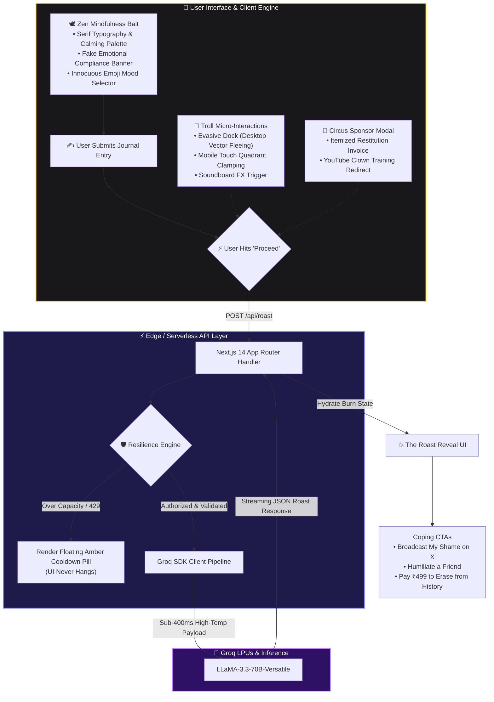

# 🍋 LemonAid

> **The world’s most deceptive mindfulness app.** Take a deep breath, share your proudest accomplishment, and watch our high-velocity AI tear your self-worth to shreds in under 400 milliseconds.

[](https://lemon-aid-app.vercel.app)
[](https://nextjs.org/)
[](https://www.typescriptlang.org/)
[](https://groq.com/)
[](https://tailwindcss.com/)

---

## ⚡ Try It Live

Test your emotional resilience right now in production:

👉 **[https://lemon-aid-app.vercel.app](https://lemon-aid-app.vercel.app)**

*Best experienced with audio turned on, your ego checked at the door, and an open tolerance for unprovoked hostility.*

---

## 🏗️ Architecture & System Design

GitHub automatically renders the interactive flowchart below:



### 🔄 Complete End-to-End Data Pipeline

```text
┌────────────────────────────────────────────────────────────────────────┐
│                        1. CLIENT BROWSER                               │
│  - Zen bait journal interface with serene mindfulness aesthetics       │
│  - Form capture & optimistic button loading state                      │
└───────────────────────────────────┬────────────────────────────────────┘
                                    │ HTTP POST { entry, mood }
                                    ▼
┌────────────────────────────────────────────────────────────────────────┐
│                   2. NEXT.JS 14 APP ROUTER API                         │
│  - Location: web/app/api/roast/route.ts                                │
│  - Payload sanitization, temperature control, and persona injection    │
│  - Intercepts 429 rate limits & falls back to localized humor pills    │
└───────────────────────────────────┬────────────────────────────────────┘
                                    │ Groq SDK (LPU accelerated)
                                    ▼
┌────────────────────────────────────────────────────────────────────────┐
│                      3. GROQ INFERENCE CLUSTER                         │
│  - Engine: llama-3.3-70b-versatile (sub-400ms execution)               │
│  - Generates custom, razor-sharp psychological burns                   │
└───────────────────────────────────┬────────────────────────────────────┘
                                    │ JSON response payload
                                    ▼
┌────────────────────────────────────────────────────────────────────────┐
│                     4. REVEAL & TROLL RUNTIME                          │
│  - Replaces tranquil input with high-impact roast card                 │
│  - Desktop dock computes cursor proximity vectors and flees            │
│  - Mobile dock locks to bottom quadrants and unlocks on tap #2         │
│  - Sponsor modal triggers professional clown training protocol         │
└────────────────────────────────────────────────────────────────────────┘
```

### 🛠️ Complete Tech Stack

| Layer | Technology | Role & Engineering Purpose |
| :--- | :--- | :--- |
| **Frontend Core** | Next.js 14.2 (App Router) & React 18 | Server-rendered shell, client interaction islands, and edge-ready API routes. |
| **Language & Typing** | TypeScript 5.0 | End-to-end type safety across client UI states, physics coordinates, and LLM payloads. |
| **Styling & Themes** | Tailwind CSS 3.4 | Fluid responsive breakpoints, dual dark/light zen color palettes, and custom keyframes. |
| **Inference Engine** | Groq Cloud API | Sub-400ms streaming responses powered by LPUs running `llama-3.3-70b-versatile`. |
| **Aux Backend** | FastAPI + Pydantic v2 | Python microservice (`api/main.py`) providing alternative strict validation endpoints. |
| **Dynamic Assets** | @vercel/og | Dynamic on-the-fly generation of tranquil, deceptive social share quote cards. |
| **Hosting & CI/CD** | Vercel Edge Network | Global CDN edge routing, automated branch deployments, and serverless compute. |

## 📖 Complete Summary & Feature Breakdown

1. 🕊️ **The Bait-and-Switch (Satirical UX)**
   - **Tranquil Disguise**: Uses elegant typography, gentle prompt cues ("What brought you genuine peace today?"), and faux-reassuring privacy banners ("We value your emotional compliance. We do not use tracking cookies, but we appreciate the illusion of choice").
   - **The Emotional Trap**: Once you document an achievement, the screen instantly snaps into a brutal, satirical takedown of your ego powered by Groq's low-latency inference.
   - **Audio Soundboard**: Integrates satirical sound effects that punctuate the reveal.

2. 🤹 **The Evasive Developer Dock**
   - **Desktop Cursor Evasion**: Employs vector collision geometry. When the cursor breaches an 80px radius around the dock, the component calculates the inverse angle and hops across the screen.
   - **Mobile Touch Clamping**: Automatically detects touch environments (`pointer: coarse` or screens under 768px). To ensure the dock never blocks reading or covers the input form, its motion is locked strictly between the bottom corners (`bottom-4 left-4` ↔ `bottom-4 right-4`).
   - **Surrender State**: On the second mobile tap, the dock ceases fleeing, displays a surrender badge, and enables links for inspection.

3. 🤡 **Circus Certification Protocol (Sponsor Flow)**
   - **Satirical Invoice**: Clicking “💸 Sponsor This Disaster” opens an itemized checkout invoice calculating satirical damages, including "Emotional Restitution", "Developer Therapy Subsidies", and "Bandwidth Wasted on Fragile Egos".
   - **Clown Redirect**: Clicking “Begin Professional Clown Training” immediately redirects the user to a YouTube clown makeup tutorial.
   - **Mobile Viewport Optimization**: On small screens, the modal is constrained to `max-h-[88vh]` with internal touch scrolling to guarantee tap targets remain accessible.

4. 🛡️ **Resilient Error Boundaries & Cooldown Pills**
   - **Graceful Error Interception**: HTTP 429 rate limits and unexpected upstream errors are intercepted at both the route handler and client levels.
   - **Animated Warning Pill**: The UI triggers an animated amber/rose warning pill informing the user that the GPU cluster overheated roasting egos.
   - **Instant Recovery**: Typing new text or clicking dismiss immediately resets the application state without requiring a browser reload.

5. 📱 **Responsive Layout Flow**
   - **Mobile Flex Flow**: On viewports under 1024px, the side flanks ("Sponsor This Disaster" and "Submit Feedback") fold neatly below the primary roast card in natural document flow.
   - **Desktop Multi-Column**: On wider viewports, elements expand into a balanced three-column layout.
   - **Mobile Overlay Elimination**: Extraneous desktop-only widgets (such as the mystery crate) are cleanly hidden on mobile devices (`hidden md:flex`).

## 📁 Repository Structure

```text
Mr.Roast/
├── api/                             # Optional Python FastAPI Microservice
│   ├── main.py                      # FastAPI app instance, endpoints & CORS
│   ├── rate.py                      # Groq client fallback & prompt logic
│   └── requirements.txt             # Python dependencies (fastapi, uvicorn, groq)
├── web/                             # Next.js 14 Frontend Application
│   ├── app/
│   │   ├── api/
│   │   │   ├── og/route.tsx         # Dynamic OpenGraph image generator
│   │   │   └── roast/route.ts       # Serverless Groq API route & 429 handler
│   │   ├── favicon.ico              # App favicon
│   │   ├── globals.css              # Custom utility classes & dark theme tokens
│   │   ├── layout.tsx               # Root layout, OpenGraph metadata & fonts
│   │   └── page.tsx                 # Core UI container, flank layout & state
│   ├── components/
│   │   ├── Chrome.tsx               # App header, soundboard & theme toggles
│   │   ├── EvasiveGithub.tsx        # Mobile-safe evasive social dock
│   │   ├── FeedbackModal.tsx        # Satirical feedback submission dialog
│   │   └── SponsorCard.tsx          # Itemized receipt & clown modal
│   ├── public/                      # Static assets, SVG icons & sound clips
│   ├── package.json                 # Node dependencies & dev scripts
│   ├── tailwind.config.ts           # Breakpoints & custom animations
│   └── tsconfig.json                # TypeScript compiler configuration
└── README.md                        # Documentation
```

## 🚀 Local Development Setup

### Prerequisites

- **Node.js** (v18.17+ or newer)
- **npm**, **pnpm**, or **yarn**
- A free **Groq Cloud API Key** from [console.groq.com](https://console.groq.com)

### 1. Clone the Repository

```bash
git clone https://github.com/wadherashivankar2-cmd/LemonAid.git
cd LemonAid/web
```

### 2. Configure Environment Variables

Create a `.env.local` file inside the `web/` directory:

```env
GROQ_API_KEY=gsk_your_groq_api_key_here
NEXT_PUBLIC_APP_URL=http://localhost:3000
```

### 3. Install Dependencies & Run

```bash
npm install
npm run dev
```

Open [http://localhost:3000](http://localhost:3000) in your browser.

## 📱 Mobile Network Testing

To test touch gestures and viewport layouts on a physical mobile device over your local Wi-Fi:

```bash
# Listen on all network adapters
npm run dev -- -H 0.0.0.0
```

1. Run `ipconfig` (Windows) or `ifconfig` (macOS/Linux) to find your local IPv4 address (e.g., `192.168.1.50`).
2. Connect your smartphone to the same Wi-Fi network.
3. Open `http://<YOUR_LOCAL_IP>:3000` in your mobile browser.

## 🚢 Production Deployment

The project is pre-configured for one-click deployment on Vercel:

1. Push your repository to GitHub.
2. Import the repository into your Vercel Dashboard.
3. Set the Root Directory to `web`.
4. Add your `GROQ_API_KEY` under Environment Variables.
5. Click Deploy.

## ⚖️ Disclaimer

LemonAid is a work of satire, humor, and comedic catharsis. None of the roasts generated are intended as actual mental health advice, and no clowns were harmed in the training of these language models.
